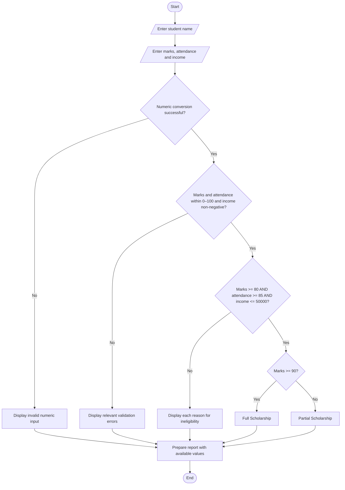
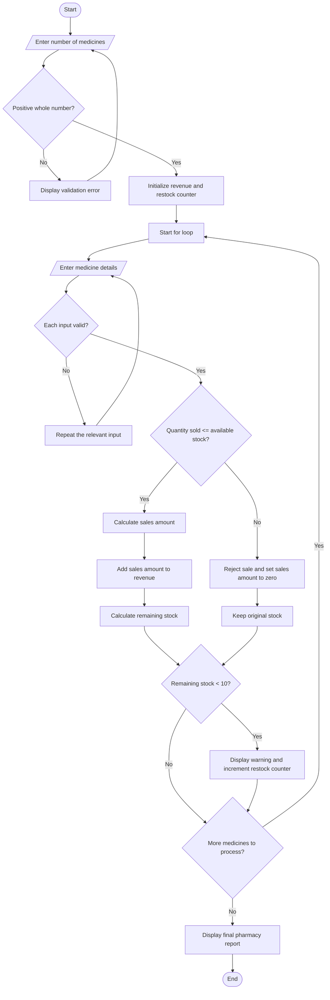

<p align="center">
  
</p>

<p align="center">
  
  
  
  
</p>

<p align="center">
  <b>Practical Python Applications: Student Scholarship Eligibility & Pharmacy Inventory Management</b><br>
  <a href="https://syedamaheen05.github.io/python-condition-loops-assessment/">🌐 Live Demo</a> ·
  <a href="#-installation--execution">⚙️ Run Locally</a> ·
  <a href="#-author">👩‍💻 Author</a>
</p>

---

## 📌 Project Overview

This repository contains two independent, console-based Python applications developed for **Assessment 1: Python Conditions & Loops**.

The projects apply fundamental programming concepts to practical scenarios:

1. **Student Scholarship Eligibility System** — evaluates scholarship eligibility using academic marks, attendance, and monthly family income.
2. **Smart Pharmacy Inventory & Sales Management System** — processes medicine sales, calculates revenue, monitors remaining stock, and identifies medicines requiring restocking.

The assessment demonstrates conditional statements, loops, input validation, exception handling, arithmetic operations, counters, accumulators, and formatted reports.

## 🌐 Live Project Preview

The interactive browser preview brings both project workflows together on one page.

**👉 [https://syedamaheen05.github.io/python-condition-loops-assessment/](https://syedamaheen05.github.io/python-condition-loops-assessment/ )**

- 🎓 Scholarship eligibility calculator
- 💊 Pharmacy sales and inventory simulator
- Input validation and generated reports

---

## 📂 Repository Structure

```text
python-conditions-loops-assessment/
│
├── assets/
│   └── banner.svg
├── student_scholarship_system.py
├── pharmacy_inventory_system.py
├── index.html
└── README.md
```

| File | Description |
|---|---|
| `assets/banner.svg` | README header banner. |
| `student_scholarship_system.py` | Evaluates student scholarship eligibility and generates a report. |
| `pharmacy_inventory_system.py` | Processes medicine sales and generates an inventory and revenue report. |
| `index.html` | Interactive browser preview for both applications. |
| `README.md` | Project documentation, workflows, instructions, and test cases. |

---

# 🎓 Application 1: Student Scholarship Eligibility System

## 1. Purpose

A university needs to evaluate scholarship applications according to academic performance, attendance, and family income. This program collects a student's details, validates numeric information, checks the eligibility conditions, determines the scholarship category, and displays an evaluation report.

## 2. Eligibility Rules

| Requirement | Condition |
|---|---|
| Academic marks | At least 80% |
| Attendance | At least 85% |
| Monthly family income | Rs. 50,000 or less |
| Full Scholarship | All criteria satisfied and marks are at least 90% |
| Partial Scholarship | All criteria satisfied and marks are from 80% to below 90% |

If one or more eligibility conditions are not met, the program displays the applicable reason or reasons. Invalid input is reported separately from ordinary ineligibility.

## 3. Inputs and Outputs

**Inputs**
- Student name
- Academic marks (%)
- Attendance (%)
- Monthly family income (Rs.)

**Outputs**
- Validation and eligibility messages
- Scholarship award, when eligible
- Reasons for ineligibility, when applicable
- Scholarship evaluation report

## 4. Workflow Diagram



## 5. Use Cases

| ID | Scenario | Expected outcome |
|---|---|---|
| UC-01 | Student meets all criteria and has 90% or higher marks | Full Scholarship |
| UC-02 | Student meets all criteria and has marks from 80% to below 90% | Partial Scholarship |
| UC-03 | Marks are below 80% | Ineligible due to academic marks |
| UC-04 | Attendance is below 85% | Ineligible due to attendance |
| UC-05 | Income exceeds Rs. 50,000 | Ineligible due to income |
| UC-06 | More than one eligibility condition fails | All applicable reasons are displayed |
| UC-07 | Alphabetic text is entered instead of a number | Invalid numeric input message |
| UC-08 | Marks or attendance are outside the 0–100 range | Relevant validation message |

## 6. Validation and Error Handling

| Field | Validation |
|---|---|
| Marks | Numeric and between 0 and 100 inclusive |
| Attendance | Numeric and between 0 and 100 inclusive |
| Family income | Numeric and non-negative |
| Numeric conversion | `ValueError` is caught using `try/except` |
| Invalid values | Scholarship eligibility is not evaluated as valid |

The program uses `is_valid` to track whether the numeric values pass validation. It initializes the numeric variables to `None`, allowing the final report to show when a value is unavailable.

## 7. Sample Execution

**Example: Full Scholarship**

```text
==== Student Scholarship System ====
Enter your name: Ayesha
Enter your academic marks (%): 95
Enter your attendance (%): 90
Enter your family income: 40000

Eligible academically!
Eligible due to attendance!
Eligible due to income criteria!
Scholarship Award: Full Scholarship!

=================================
      SCHOLARSHIP EVALUATION REPORT
=================================
Student Name: Ayesha
Academic Marks: 95.0%
Attendance: 90.0%
Family Income: Rs. 40000.0

Scholarship Status:
Eligible
```

**Example: Multiple Ineligibility Reasons**

```text
Enter your name: Ali
Enter your academic marks (%): 75
Enter your attendance (%): 80
Enter your family income: 60000

Not eligible academically!
Not eligible due to attendance!
Not eligible due to income criteria!

Student is not eligible for scholarship!

Reasons for Ineligibility:
- Academic marks are below 80%.
- Attendance is below 85%.
- Family income exceeds Rs. 50,000.
```

## 8. Test Cases

| ID | Marks | Attendance | Income (Rs.) | Expected result |
|---|---:|---:|---:|---|
| TC-01 | 95 | 90 | 40000 | Full Scholarship |
| TC-02 | 85 | 90 | 40000 | Partial Scholarship |
| TC-03 | 90 | 85 | 50000 | Full Scholarship |
| TC-04 | 80 | 85 | 50000 | Partial Scholarship |
| TC-05 | 79 | 90 | 40000 | Ineligible: marks |
| TC-06 | 90 | 84 | 40000 | Ineligible: attendance |
| TC-07 | 90 | 90 | 50001 | Ineligible: income |
| TC-08 | 70 | 75 | 60000 | All three ineligibility reasons |
| TC-09 | 101 | 90 | 40000 | Invalid marks |
| TC-10 | 90 | -5 | 40000 | Invalid attendance |
| TC-11 | 90 | 90 | -100 | Invalid family income |
| TC-12 | ABC | 90 | 40000 | Invalid numeric input |

---

# 💊 Application 2: Smart Pharmacy Inventory & Sales Management System

## 1. Purpose

A local pharmacy needs a simple way to process medicine sales, calculate daily revenue, and identify medicines that require restocking. This program processes a user-defined number of medicines, checks stock availability, calculates successful sales, updates remaining stock, and generates a final report.

## 2. Main Features

- Accepts the number of medicines to process.
- Uses a `for` loop and `range()` to process each medicine.
- Collects medicine name, available stock, unit price, and quantity sold.
- Validates numeric inputs.
- Rejects sales quantities greater than available stock.
- Calculates sales amount for successful sales.
- Calculates remaining stock.
- Displays a warning when remaining stock is below 10 units.
- Uses an accumulator for total revenue.
- Uses a counter for medicines requiring restocking.
- Generates a final pharmacy report.

## 3. Business Rules and Calculations

**Sales amount**

```python
sales_amount = quantity_sold * price_per_unit
```

**Remaining stock after a successful sale**

```python
remaining_stock = available_stock - quantity_sold
```

**Revenue accumulator**

```python
total_revenue += sales_amount
```

**Restocking counter**

```python
restock_count += 1
```

A sale is completed only when `quantity_sold <= available_stock`. An unsuccessful sale contributes zero to revenue and leaves the original stock unchanged.

## 4. Workflow Diagram



## 5. Use Cases

| ID | Scenario | Expected outcome |
|---|---|---|
| UC-01 | Requested quantity is within available stock | Sale is completed |
| UC-02 | Remaining stock is below 10 | Low-stock warning appears |
| UC-03 | Requested quantity exceeds available stock | Sale is rejected |
| UC-04 | Several medicines are entered | Each medicine is processed in the loop |
| UC-05 | Successful sale is processed | Revenue accumulator is updated |
| UC-06 | A medicine has fewer than 10 units remaining | Restocking counter increases |
| UC-07 | Negative stock or price is entered | Validation message appears |
| UC-08 | Zero or negative quantity is entered | Validation message appears |
| UC-09 | Invalid text is entered for a numeric field | `ValueError` is handled |
| UC-10 | Medicine count is zero, negative, or non-numeric | Program requests a valid positive whole number |

## 6. Validation and Error Handling

| Input | Validation rule | Handling |
|---|---|---|
| Number of medicines | Must be a positive integer | Re-prompts until valid |
| Medicine name | Collected as text | No additional name validation in the Python version |
| Available stock | Integer greater than or equal to zero | Rejects negative or non-integer values |
| Price per unit | Numeric value greater than or equal to zero | Rejects negative or non-numeric values |
| Quantity sold | Positive integer | Rejects zero, negative, or non-integer values |
| Stock availability | Quantity sold must not exceed stock | Rejects the sale when stock is insufficient |

## 7. Sample Execution

```text
===== Pharmacy Inventory System =====
How many medicines do you want to process? 2

--- Medicine 1 ---
Enter medicine name: Panadol
Enter available stock: 25
Enter price per unit: 20
Enter quantity sold: 18
Sales amount: Rs. 360.0
Remaining stock: 7
WARNING: Panadol is low in stock. Restocking is required!

--- Medicine 2 ---
Enter medicine name: Syrup
Enter available stock: 30
Enter price per unit: 100
Enter quantity sold: 10
Sales amount: Rs. 1000.0
Remaining stock: 20

=================================
       PHARMACY SALES REPORT
=================================
Total medicines processed: 2
Total pharmacy revenue: Rs. 1360.0
Medicines requiring restocking: 1
```

**Example: Insufficient Stock**

```text
Enter medicine name: Antibiotic
Enter available stock: 10
Enter price per unit: 50
Enter quantity sold: 15

Insufficient stock! Sale cannot be completed.
Remaining stock: 10
```

## 8. Test Cases

| ID | Available stock | Unit price | Quantity sold | Expected result |
|---|---:|---:|---:|---|
| TC-01 | 50 | 20 | 20 | Sale Rs. 400; remaining 30 |
| TC-02 | 15 | 50 | 8 | Sale Rs. 400; remaining 7; warning |
| TC-03 | 10 | 100 | 15 | Sale rejected; stock remains 10 |
| TC-04 | 10 | 50 | 10 | Sale Rs. 500; remaining 0; warning |
| TC-05 | 0 | 100 | 5 | Sale rejected |
| TC-06 | -5 | 20 | 2 | Negative stock rejected |
| TC-07 | 20 | -10 | 5 | Negative price rejected |
| TC-08 | 20 | 50 | 0 | Zero quantity rejected |
| TC-09 | 20 | 50 | -3 | Negative quantity rejected |
| TC-10 | 20 | ABC | 5 | Invalid price input handled |
| TC-11 | 20 | 50 | ABC | Invalid quantity input handled |

---

# 🧠 Python Concepts & Techniques

| Concept | Used in | Purpose |
|---|---|---|
| Variables and data types | Both | Store input and application data |
| `input()` and `print()` | Both | Collect and display information |
| Type conversion | Both | Convert input strings to numeric values |
| `if`, `elif`, `else` | Both | Make decisions |
| Logical operators (`and`, `or`) | Scholarship | Combine eligibility conditions |
| Nested conditions | Scholarship | Determine scholarship category |
| `try/except` | Both | Handle invalid numeric conversion |
| `while` loop | Both | Repeat input until valid |
| `for` loop | Pharmacy | Process multiple medicines |
| `range()` | Pharmacy | Control loop iterations |
| Accumulator | Pharmacy | Maintain total revenue |
| Counter | Pharmacy | Count medicines requiring restocking |
| Arithmetic operators | Both | Perform calculations |
| F-strings | Both | Format messages and reports |

## 🧪 Testing Approach

The test cases above cover:

- **Functional testing:** Confirm that each requirement works.
- **Boundary value testing:** Check values around scholarship thresholds and the low-stock threshold.
- **Negative testing:** Enter negative, zero, and out-of-range values where applicable.
- **Input validation testing:** Check invalid data types and numeric ranges.
- **Calculation testing:** Verify sales amounts, remaining stock, and total revenue.
- **Decision testing:** Confirm scholarship awards, ineligibility reasons, and restocking warnings.

Important boundary values include:

- Scholarship marks: 79%, 80%, 89%, 90%, and 100%.
- Attendance: 84%, 85%, and 100%.
- Family income: Rs. 50,000 and Rs. 50,001.
- Pharmacy remaining stock: 9, 10, and 11 units.
- Sales quantity: zero, exactly available stock, and more than available stock.

> Test cases in this README describe expected outcomes. They should be run against the Python programs to confirm actual results.

---

# ⚙️ Installation & Execution

## Requirements

- Python 3.x
- Visual Studio Code or another Python editor
- Terminal or command prompt
- Git (for cloning the repository)

## 1. Clone the Repository

```bash
git clone https://github.com/Syedamaheen05/python-conditions-loops-assessment.git
```

## 2. Open the Project Folder

```bash
cd python-conditions-loops-assessment
```

## 3. Run the Student Scholarship System

```bash
python student_scholarship_system.py
```

## 4. Run the Pharmacy Inventory System

```bash
python pharmacy_inventory_system.py
```

On Windows, if `python` is not recognized, try `py`:

```bash
py student_scholarship_system.py
py pharmacy_inventory_system.py
```

Both Python programs use built-in Python functionality and do not require external packages.

---

# 🚀 Future Enhancements

### Student Scholarship System
- Save student applications for future reference.
- Generate downloadable scholarship reports.
- Support additional scholarship categories.
- Add a graphical user interface.
- Integrate a database.

### Pharmacy Inventory System
- Add, update, and delete medicine records.
- Save inventory data permanently.
- Generate daily and monthly sales reports.
- Track medicine expiry dates.
- Add automatic restocking notifications.
- Integrate a database.

---

# 📈 Learning Outcomes

By developing these applications, I practiced:

- Translating real-world requirements into programming logic.
- Applying conditional statements to decision-making problems.
- Using loops to automate repetitive tasks.
- Validating user input and handling exceptions.
- Understanding counters and accumulators.
- Performing arithmetic calculations and generating reports.
- Testing normal, boundary, and invalid input scenarios.
- Organizing and documenting projects on GitHub.

---

# 👩‍💻 Author

**Syyeda Maheen Bukhari**

IT Graduate | Python Learner | Web Development

[](https://github.com/Syedamaheen05)
[](https://www.linkedin.com/in/syeda-maheen-bukhari-5a5009406/)

---

## 📜 Assessment Details

| Detail | Information |
|---|---|
| Assessment | Assessment 1 |
| Topic | Python Conditions & Loops |
| Language | Python |
| Applications | 2 |
| Application type | Console-based Python programs |
| Submission platform | GitHub |

**Learning by building, testing, and improving — one Python project at a time.** 🐍
